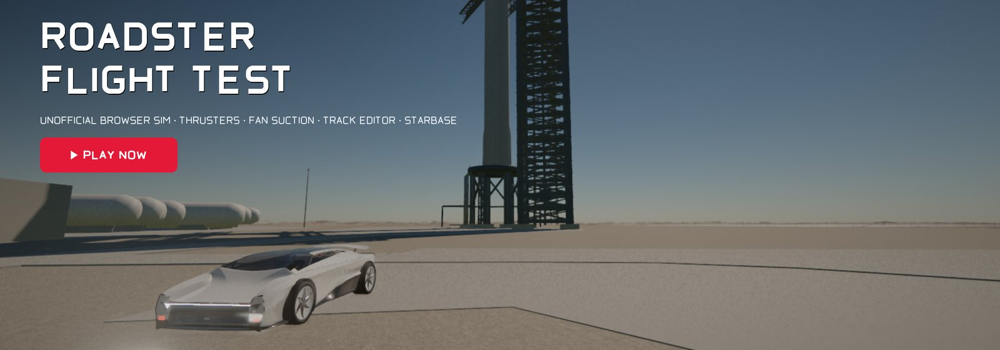

# Roadster Flight Test

<p align="center">
  <a href="https://roadster.ageco-labs.de"></a>
</p>
<p align="center">
  <a href="https://roadster.ageco-labs.de"></a><br>
  <sub><a href="https://roadster.ageco-labs.de">roadster.ageco-labs.de</a> · also on
  <a href="https://ancient2k.github.io/roadster-flight-test/">GitHub Pages</a> · runs in the browser, no install
  needed (desktop with WebGPU recommended)</sub>
</p>

A free, unofficial browser simulation of the 2nd-generation Tesla Roadster as it was shown on 15 October 2026
at the SpaceX test site in McGregor, Texas: cold-gas thrusters, fan suction, short flights. Real-time physics
(Rapier plus a custom thermodynamic and GNC stack), WebGPU rendering with a WebGL2 fallback, no backend.

> **Unofficial fan project.** Not affiliated with Tesla, Inc. or SpaceX. "Tesla", "Roadster" and related names
> are trademarks of their owners and are used descriptively only. All vehicle models are our own script-built
> replicas without logos.

## What's inside

- **Auto mode:** the autopilot re-flies the five stunts from the livestream – upside-down ramp, ramp launch,
  kickflip over the Semi, 0–60 mph in 0.81 s, ground-start flip. Purely physical and only through drive and
  valve commands; the result screen compares the telemetry with the HUD values from the stream.
- **Manual mode:** drive and fly freely with three assist levels (ASSIST, STABILIZED, RAW).
- **Eleven sites:** McGregor test site, Stonehenge, the Giza Plateau and Boca Chica with the Starbase launch site on Earth; Tranquility Base, Hadley Rille and
  Shackleton crater on the Moon; Jezero, Gale and Valles Marineris on Mars – with real gravity, atmosphere and
  terrain data from NASA, USGS and Copernicus. Plus the Sun: Roadster 1 with Starman and the "Sun dive".
- **Hands-on physics:** the Giza pyramids can be driven up with the fans on suction. Lunar modules, rovers and
  the stones of Stonehenge can be knocked over; they break when the impact energy is high enough. Roadster 1 can
  be rammed, and a panel shows its new orbit around the Sun. On the Moon, on Mars and at Giza the wheels kick up
  dust and leave tracks, and the thrusters blow the ground clear.
- **Vehicle damage** (Settings → Simulation, Off / Visual / Full): crashes dent the body and tear off the wing,
  doors, bumpers, diffuser, nozzle covers and wheels, which fly as real parts of the model. With "Full" the
  missing parts change how the car drives, and a heavy crash destroys it – reset (Backspace) to repair.
- **Driving physics** (Settings → Simulation, Fun / Realistic): *Fun* (default) adds the helpers sim-arcade games
  use – a wall guides a car that glances off it along and lines it up, the spin after a hard crash is damped for a
  moment, landings give no rebound. *Realistic* is the plain model; the auto stunts always run realistic.
- **Track editor** in the spirit of the classic DOS racers: build your own course on a 960 × 720 m field next to
  Starbase (Boca Chica, Texas) from 17 pieces – loops, jumps, banked curves, elevated roads, half-pipe, the
  stream's wall ramp, fly-through rings, boost pads, air stations and a launch clearance – then test-drive it at
  once against the clock. Tracks are saved in the browser, as files and as share links (see
  [docs/EDITOR.md](docs/EDITOR.md)).
- **Starship launch:** the launch clearance piece (or the finish line) starts a countdown at Starbase – water deluge,
  33 Raptors, a cloud of steam and sand, a pressure wave that shoves cars inside the exclusion ring, the ascent over
  the Gulf and hot staging. Super Heavy flies back and is caught by the tower arms after ≈ 7 minutes; Starship
  returns after one orbit (time lapse) and is caught by the second tower. Stream-style ticker messages, a flight
  display with altitude, speed and trajectory, and an arrow to the returning stage tell you when to be back at the pad.
- **14 UI languages** (see [Languages](#languages)).

## Getting started

```bash
npm install
npm run dev          # http://127.0.0.1:5173
```

Production build and web package (static site, no backend):

```bash
npm run build        # output in dist/
npm run package      # release/roadster-flight-test-<date>-<commit>.zip incl. licences and LIESMICH.txt
```

The site runs on any static host (GitHub Pages, Cloudflare Pages, your own web server), also in a
sub-folder. WebGPU requires HTTPS; without WebGPU the game switches to WebGL2 with reduced effects
automatically. A GitHub Pages workflow is in `.github/workflows/pages.yml`.

**Browsers:** automatically tested with Chromium on macOS (Apple M1 Pro), with WebGPU and with the WebGL2
fallback. A desktop with a dedicated or Apple-silicon GPU is recommended. Download size: ≈ 21 MB at the start
(program, car, McGregor), plus 9–16 MB per world.

**Install as an app:** the site is a Progressive Web App. Chrome and Edge (desktop and Android) offer
*Install* in the address bar or menu; on iPhone and iPad use Safari's *Share → Add to Home Screen*. The app
starts full-screen in landscape. After one visit it also starts **offline**: the program, the McGregor scene and
every world you have opened are kept in the browser cache; worlds you have not opened yet need a connection.
A new version installs in the background and is used from the next start. Details in
[docs/MOBILE.md](docs/MOBILE.md#install-as-an-app). Phones and tablets get touch controls; see the same page.

URL parameters: `?q=low|medium|high|ultra` (graphics), `?stunt=<id>` (straight into a stunt), `?nomenu`,
`?webgl`, `?lang=<code>` (UI language, e.g. `?lang=ja`), `?touch` (touch controls on a desktop), `?nosw`
(removes the offline cache and the service worker).

## Controls

Default bindings; they can be changed in the game under Settings → Controls.

| Action | Keyboard | Gamepad |
|---|---|---|
| Throttle / brake / steer | W / S / A, D | RT / LT / left stick |
| Handbrake (rear wheels locked: handbrake turns and drifts) | X | B |
| Reverse | S at standstill (release and press again after braking to a stop); W returns to forward | LT at standstill |
| Lift thrusters | Space | A |
| Rear thrusters (boost) | Shift | X |
| Pitch / roll / yaw | K, I / Q, E / J, L | right stick / LB, RB |
| Fans · aero · compressor · assist | F · V · R · N | D-pad |
| Camera · slow motion · photo mode | C · T · F2 | Y · R3 |
| Turn / zoom the chase camera | drag with the left (or right) mouse button · mouse wheel; it swings back behind the car after ≈ 2 s of driving | – |
| Pause · restart · menu · help | P · Backspace · Esc · F1 | Menu · View |
| Start the Sun dive / time warp | Enter / PageUp, PageDown | – |

**Phones and tablets** get on-screen touch controls (see [docs/MOBILE.md](docs/MOBILE.md#what-happens-on-a-phone)).
Optional **tilt steering** (off by default): switch it on with the **TILT** button in the touch HUD or under
Settings → Controls → *Tilt steering*. Leaning the phone back / forward is pitch (nose up / down), lowering the
right / left edge is roll; the attitude stick and the roll buttons still work and add up with it, steering and
throttle stay on the left stick. The way you hold the phone when switching on, at every start/restart and on
**⊙** (Recenter) is the centre; dead zone ≈ 3°, full deflection ≈ 25° at sensitivity 1 (adjustable 0.3–3).
iOS asks for motion-sensor access on the first tap; if access is denied or there is no sensor, the option stays off
with a hint.

The compressor (R) refills the tank. With Settings → Simulation → Compressor on **Fun** (default) a full tank
takes 20 s on every world (off Earth from an on-board supply, a simplification); **Realistic** takes 6–7 h and only
works on Earth, since there is no air to draw in on the Moon or in space and Mars is far too thin.

## Languages

The UI is available in **English** (source language and fallback), **German**, French, Spanish, Italian,
Portuguese (Brazil), Dutch, Polish, Russian, Ukrainian, Turkish, Japanese, Korean and Simplified Chinese.
The language follows the browser preferences (`navigator.languages`, best match) and can be changed under
Settings → Display → Language; `?lang=<code>` overrides both. Numbers and dates use the locale's format.

- Strings live in `src/i18n/locales/<code>.ts` with stable keys (`menu.stunts`, `hud.tankPressure`, …);
  `en.ts` is the source. `tests/ui/i18n.test.ts` checks that every locale has the same keys and placeholders,
  no empty values, all plural forms the language needs, and no forgotten English text.
- **The non-English/German strings are machine translations – corrections are welcome** (a pull request against
  the locale file is all it takes).
- The HUD ring captions `G-FORCE`, `DOWNFORCE`, `PITCH`, `ALTITUDE`, the unit labels (`FT`, `MPH`, `KG`) and the
  0–60 timer stay in English in every language, because they reproduce the Tesla stream graphics.
- The project's display font "RFT Display" covers Latin (including the accented letters of the shipped
  languages) and Cyrillic. Japanese, Korean and Chinese text is rendered with the system font.
- **No right-to-left languages yet (Arabic, Hebrew).** The menus, the canvas HUD (absolute left/right anchors,
  right-aligned value columns) and the result chart are laid out for left-to-right text; a proper RTL version
  needs mirrored layouts and bidirectional text handling on the canvas, not just translated strings. Adding a
  half-mirrored UI would be worse than none.

## Tests

```bash
npm run typecheck
npm test             # Vitest: physics, tank/thrusters/valves, GNC, stunts incl. Monte Carlo and step-size convergence, worlds, UI logic, locales
npm run test:e2e     # Playwright against the production build: menu, 5 stunts in real time, free play, WebGL2, all worlds, load times, all 14 languages, installable app + offline start
npx playwright test tests/e2e/mobile --project=phone-small --project=pixel7   # phone emulation: touch controls, HUD layout, tilt steering
```

The E2E tests need a browser with a GPU (Playwright starts Chromium with WebGPU); CI therefore runs only the
type check and Vitest.

## Project layout

| Path | Contents |
|---|---|
| `src/shared/` | Contracts: types, parameter register `roadster.ts` (with the source of every value), track, worlds, reference values from the stream |
| `src/sim/core/` | Simulation core: Rapier world, compressed-air tank (Abel–Noble, energy balance), regulator, thrusters, valves, movable objects |
| `src/sim/vehicle/` | Suspension, tyres (Pacejka), ground types (Bekker/Wong), fan suction, aerodynamics |
| `src/sim/gnc/`, `src/sim/stunts/` | Thrust allocation (hierarchical QP), SO(3) attitude control, landing guidance, autopilot, stunt state machines |
| `src/render/` | WebGPU/TSL renderer, volumetric clouds, thruster jets, particles, cameras; `src/render/worlds/` terrain, sky, Sun |
| `src/ui/`, `src/input/`, `src/audio/` | Stream-style HUD, menus, input (keyboard/gamepad), procedural audio |
| `src/i18n/` | Localisation: `t()`, plurals, number formats, language detection, the 14 locale files |
| `src/game/` | Game loop, sessions, world switching, Sun dive, orbit of Roadster 1 |
| `tools/` | Blender scripts for all models, world data pipeline, GNC tools (Monte Carlo, sweeps), web package, service worker + app icons (`tools/pwa/`, `tools/make-icons.mjs`) |

Technical background: [docs/PHYSICS.md](docs/PHYSICS.md) (vehicle, propulsion, control, validation) and
[docs/RENDERING.md](docs/RENDERING.md) (graphics, worlds, asset pipeline). Known limitations:
[docs/KNOWN_LIMITATIONS.md](docs/KNOWN_LIMITATIONS.md).

## License

Code, our own models, textures and documentation are released under the [MIT License](LICENSE).
Third-party data (NASA, USGS, Copernicus, Poly Haven) and the libraries three.js and Rapier keep their own
licences – overview and attributions in [NOTICE.md](NOTICE.md).
